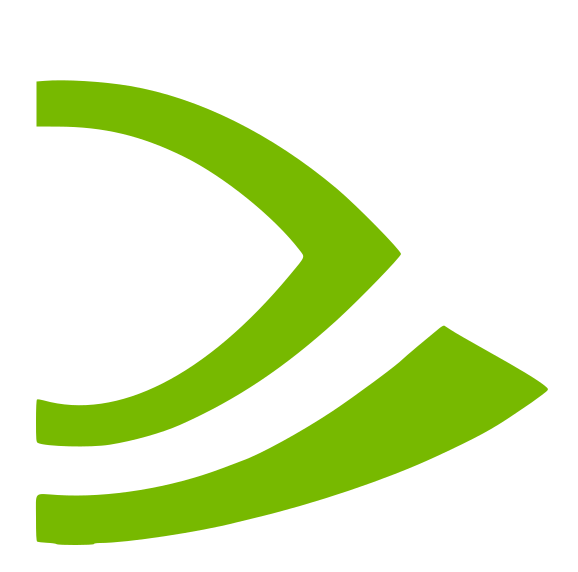

<p align="center">
  
</p>

<h1 align="center">ShieldDeck</h1>

<p align="center"><b>DroidDeck on the NVIDIA Shield TV.</b><br>Valve's Steam client in Big Picture on a Tegra X1 box, rendered on the CPU for now.</p>

ShieldDeck is a work-in-progress fork of [DroidDeck](https://github.com/Droid-Deck/DroidDeck) (the upstream project's own README is [`README.md`](../README.md) in this repo; its build, install and credits sections still apply). DroidDeck assumes an Adreno GPU with the Turnip driver. The Shield TV has none of that, so this fork reworks the launcher, runtime and patched gamescope until the whole stack runs on a stock, locked-bootloader Shield.

> **Status: experimental, not usable yet.** The Steam client starts and stays alive on a Shield TV, but its first UI frame has not been confirmed on screen. Nothing here is a release.

## Target hardware

| | |
|---|---|
| Device | SHIELD Android TV (2019 `mdarcy` family; 3 GB model tested) |
| SoC | Tegra X1 / X1+ (T210 / T214), 4x Cortex-A57, Maxwell GPU. No LSE atomics, no TSO |
| OS | Android 11, Shield Experience 9.x, kernel 4.9.141-tegra, SELinux enforcing |
| Memory / storage | ~2.9 GiB RAM, 512 MB swap, ~12 GB `/data` |
| Bootloader | Locked, no root. No `/dev/dri`, so no NVK or other DRM Vulkan drivers on this kernel |

## How it works today

The Shield's GPU driver (`vulkan.tegra.so`) is linked against Android's libc and cannot be used from DroidDeck's glibc guest without a bridge that does not exist yet. So ShieldDeck currently uses software rendering:

- **Rendering:** Mesa lavapipe (`libvulkan_lvp`) is the guest Vulkan driver. The zink/freedreno environment overrides are skipped on Tegra.
- **Compositor:** gamescope 3.16.29 with this fork's patches (below), built by CI on ARM64.
- **Steam client:** pinned to ARM64 build `1776387948`, the last one built for ARMv8.0. Newer builds need LSE atomics and die with SIGILL on the Cortex-A57. A `Steam.cfg` with `BootStrapperInhibitAll=Enable` stops the client updating itself past the pin.
- **Steam UI (CEF):** launched with `-cef-disable-gpu`, `LP_NUM_THREADS=2`, and a world-writable `/tmp/dumps` so crash dumps are captured.
- **Android side:** Tegra is detected as an untested device (warns, never blocks), Adreno-only gates are skipped, and the manifest declares an optional Leanback launcher so one APK still installs on phones.

## What works / what doesn't

| Milestone | State |
|---|---|
| App boots past Adreno-specific gates on Tegra | Done |
| gamescope starts and stays up under lavapipe | Done (patches 0116, 0122, 0123) |
| Steam client installs and runs (pinned build) | Done |
| Steam UI paints its first frame | **Open.** Current blocker; see `docs/shield-tv-handoff.md` |
| Game launch and a measured FPS/RAM figure | Not started |
| Onboard GPU (Phase 2) | Deferred. Needs a bridge to the bionic driver, or an unlocked bootloader and custom kernel |

The first-frame problem is that Steam's X11 window never produced a completed commit, so gamescope withheld focus and presented nothing. Patch 0123 now treats a missing dma-buf fence as ready, because lavapipe cannot export one. Whether that clears the blocker is not yet confirmed.

## Changes from upstream

Everything below lives on the `shield-tv` branch. Files are added or edited in place; nothing is renamed or moved.

**Launcher / runtime** (`app/src/main/java/com/droiddeck/launcher/`): `DeviceSupport`, `GpuInfo`, `SocNames` and `DriverPairs` (Tegra family, untested-device handling, test `tegraIsDetectedAndWarnsInsteadOfBlocking`); `TurnipDriver`, `LinuxVulkanDriverManager`, `LinuxRuntime` and `BwrapSpawner` (no Turnip unpack on Tegra, ICD preference NVK > lavapipe/swrast > freedreno, device-node gating); `SessionService` (Tegra environment). `AndroidManifest.xml` adds the Leanback launcher and makes the touchscreen optional.

**Session / Steam install scripts** (`tools/linuxfs/overlay`): Steam client pinning with exec-bit repair, `Steam.cfg` update suppression, CEF software-rendering flags, crash-dump directory.

**gamescope patches** (`tools/gamescope/patches/`), applied on top of the existing DroidDeck series:

| Patch | Purpose |
|---|---|
| `0116` | Return failure instead of asserting when a texture allocation fails (`findMemoryType` returned -1, cast to `uint32_t`) |
| `0117`-`0121` | Diagnostic bisect of the `vkAllocateMemory` failure under lavapipe. **Remove before any release build** |
| `0122` | Only request dma-buf export when the ICD reports support for it. Fixes the original gamescope crash |
| `0123` | Shared-memory output fallback for ICDs that cannot export dma-bufs, treat a missing commit fence as ready, plus focus/commit diagnostics (also to be removed before release) |

**Tooling and docs:** `tools/shield-probe.sh` (read-only adb probe), [`docs/shield-tv.md`](../docs/shield-tv.md) (port notes, Phase 0 probe results, scope decisions), [`docs/shield-tv-handoff.md`](../docs/shield-tv-handoff.md) and [`docs/continue-handoff.md`](../docs/continue-handoff.md) (session-by-session state, commands and verified facts).

## Building and running

Build the APK as described in the upstream [README](../README.md#build). The gamescope binary comes from CI, not a local build: pushing changes under `tools/gamescope/**` (or dispatching `build-gamescope.yml`) builds it on an ARM64 runner, and the result is dropped into `app/src/main/assets/linuxfs/usr/local/bin/gamescope` before packaging. The session restages that file from the APK on every start, so pushing a binary straight into the guest does not stick.

```sh
./gradlew :app:assembleRelease
adb -s <shield-ip>:5555 install -r app/build/outputs/apk/release/app-release.apk
python3 tools/droiddeckctl --serial <shield-ip>:5555 start steam
```

Session logs are in the app's private `files/logs/<session-id>/session.log`; Steam's own logs are under `files/linuxfs/root/.local/share/Steam/logs/`.

## Branches

- `main` tracks upstream DroidDeck. Do not commit port work here.
- `shield-tv` is the port. Rebase it onto upstream when upstream moves.

## Contributing

This project is **not ready for use yet** — expect breakage. Contributions are welcome regardless: open an issue or PR against `shield-tv`.

## AI usage

Parts of this fork (code, patches and docs) were drafted with AI assistance and reviewed by the maintainer before landing.

## Credits and licence

GPL-3.0, like upstream. ShieldDeck is built on [DroidDeck](https://github.com/Droid-Deck/DroidDeck) and inherits its credits (see the upstream README), plus [gamescope](https://github.com/ValveSoftware/gamescope) and [Mesa](https://gitlab.freedesktop.org/mesa/mesa) lavapipe. See [LICENSE](../LICENSE).

NVIDIA, SHIELD and Tegra are trademarks of NVIDIA Corporation. Steam and Proton belong to Valve Corporation. This project is not affiliated with NVIDIA or Valve.
